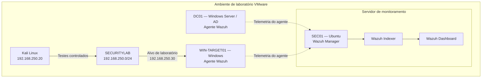

# Arquitetura do laboratório

## Visão lógica

> O desenho representa os componentes e os fluxos lógicos documentados. Não deve ser interpretado como um mapa completo de interfaces, VLANs, rotas ou regras de firewall. A conectividade física/lógica entre todas as redes precisa ser documentada separadamente antes de afirmar detalhes adicionais.

## Componentes

| Componente | Papel documentado |
|---|---|
| SEC01 | Servidor Ubuntu com Wazuh |
| Wazuh Manager | Análise de eventos e regras |
| Wazuh Indexer | Indexação e armazenamento |
| Wazuh Dashboard | Consultas, monitoramento e threat hunting |
| DC01 | Windows Server / Active Directory |
| WIN-TARGET01 | Endpoint Windows de testes |
| Kali Linux | Origem de testes controlados de rede |

## Segmento SECURITYLAB

| Host | Endereço | Função |
|---|---|---|
| Kali Linux | `192.168.250.20` | Origem dos testes |
| WIN-TARGET01 | `192.168.250.30` | Alvo Windows |

A rede `192.168.250.0/24` foi descrita como isolada da Internet.
